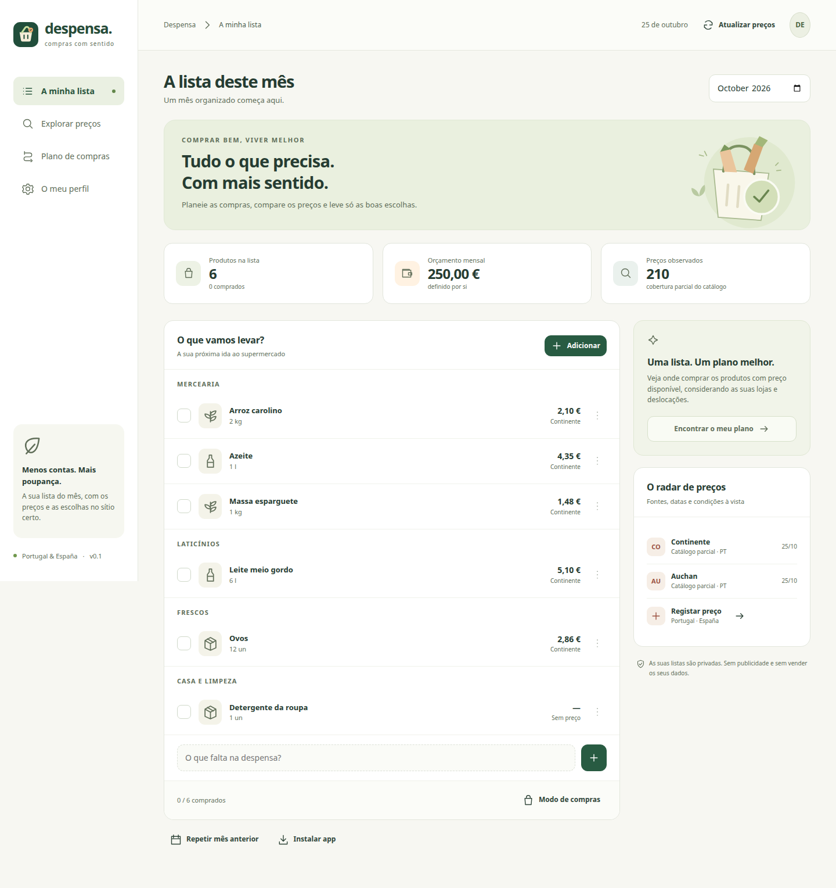
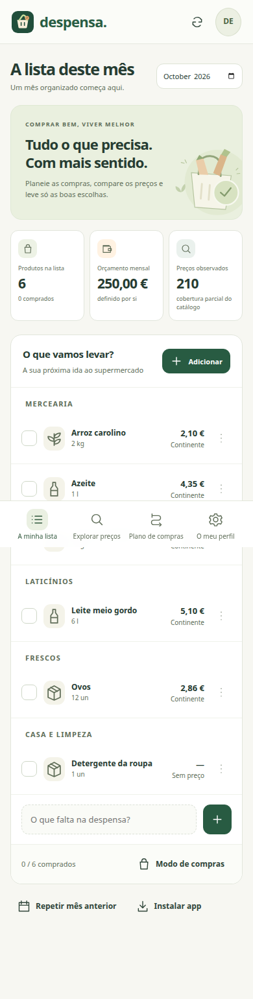
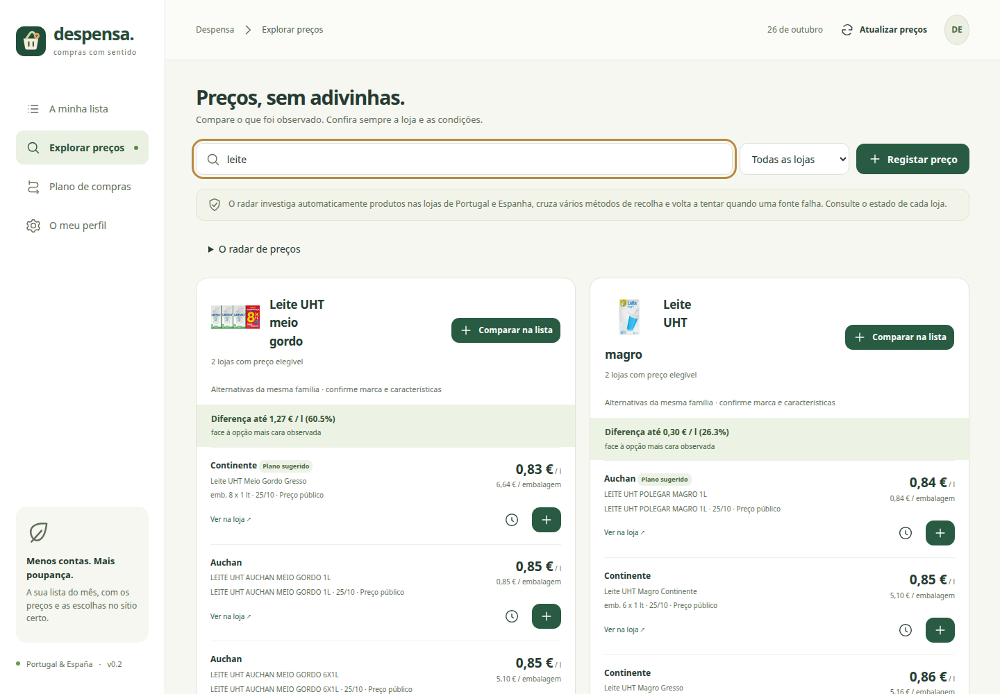
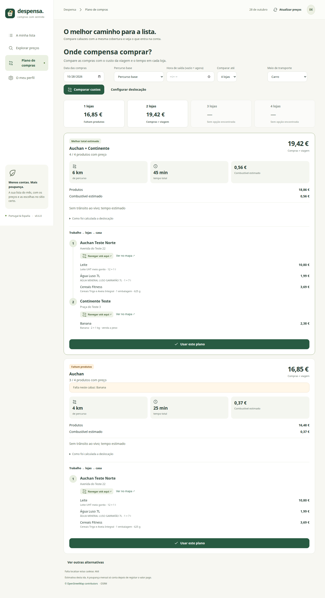

<p align="center"></p>
<h1 align="center">Despensa</h1>
<p align="center"><strong>Compras com sentido. Compras con sentido.</strong><br>A sua lista, os preços à vista e um plano para comprar melhor em Portugal e Espanha.</p>
<p align="center"><a href="#começar">Instalar</a> · <a href="docs/README.es.md">Español</a> · <a href="docs/SOURCES.md">Fontes e metodologia</a> · <a href="CONTRIBUTING.md">Contribuir</a></p>



Despensa é uma aplicação de compras pessoais que pode alojar no seu computador ou NAS. Organiza listas mensais, guarda as suas preferências e compara os produtos para os quais existem preços observados. A interface funciona em português europeu e espanhol, no computador e no telemóvel.

**Versão 0.6: planos guardados, custos de viagem e comparação até quatro lojas.** A aplicação descobre páginas, combina vários métodos de leitura, guarda o progresso e repete fontes que falham. O radar mostra a cobertura efetivamente conseguida em cada loja; uma fonte sem resposta nunca aparece como um preço encontrado.

## O que já pode fazer

- Entrar diretamente com Authelia numa instalação configurada para SSO, ou usar contas locais independentes com controlo para mostrar a palavra-passe.
- Escolher sugestões de famílias ou referências específicas, incluindo Café Delta e cereais Fitness: preenche categoria, unidade e quantidade publicada, preservando alterações manuais. As sugestões acompanham a investigação enquanto a janela estiver aberta.
- Organizar produtos por mês e categoria, com quantidades, notas e data de compra; repetir o mês anterior.
- Usar um modo de compras com controlos maiores e lista offline. Alterações feitas offline ficam numa fila local e sincronizam quando regressa a ligação e a sessão continua válida.
- Pesquisar por nome, marca, formato, plurais e palavras incompletas, com tolerância a pequenos erros de escrita. Selecionar Portugal, Espanha ou ambos e carregar mais resultados sem cortar o catálogo nos primeiros 200 produtos.
- Consultar imagens, comparação por litro/kg/unidade, fonte, data e histórico. Os grupos são calculados antes da paginação, para uma loja não desaparecer da comparação por ter um preço mais alto.
- A pesquisa tem uma fila prioritária e dois investigadores independentes da recolha geral. Os resultados e o progresso por loja atualizam-se sem recarregar a página.
- Investigar lojas de Portugal e Espanha através de catálogos, JSON-LD, dados de produto embebidos, microdados e mapas oficiais do site. A fila persistente dá prioridade aos produtos pedidos, reparte as consultas pela lista e continua a descobrir o catálogo entre recolhas. O servidor trabalha com a app fechada; a atualização periódica é configurável entre 6 e 168 horas.
- Pesquisar fruta e carne vendidas ao kg, incluindo quantidades inferiores a 1 kg e embalagens de peso aproximado.
- Encontrar produtos por marca e formato mesmo quando o volume não aparece no endereço da página; o Auchan tem também pesquisa direta no catálogo público.
- Distinguir preços públicos e Lidl Plus nos dados de catálogo; ler dados públicos da Makro ES com IVA e identificação do centro. Preços de um centro específico ficam fora do plano até ser possível confirmar a loja.
- Consultar automaticamente o folheto digital oficial do Recheio, com validade e preços Cash sem IVA explicitamente identificados e excluídos dos planos pessoais. O catálogo público da Makro PT permite descobrir referências, mas continua a pedir sessão da loja para revelar preços.
- Registar preços de lojas físicas de Portugal e Espanha, incluindo Makro e Recheio, formato, IVA, localização, validade, cartão, subscrição ou cupão específico.
- Definir lojas acessíveis, cartões e códigos de cupão. Subscrições aparecem apenas onde existe um programa identificado: EntregaZero é uma subscrição de entregas, sem assumir descontos nos produtos.
- Comparar até quatro lojas por ida, comprando embalagens inteiras. Em produtos embalados com conteúdo em kg/l, «1 un» pede uma embalagem; «1 kg» pede massa suficiente e pode precisar de várias. O formato escolhido fica visível. Os cabazes incompletos são identificados e nunca vencem um completo por omitir produtos.
- Separar o valor pago hoje do saldo futuro em cartão.
- Localizar casa e trabalho, guardando imediatamente cada localização escolhida, descobrir lojas perto de ambos e estimar automaticamente os quilómetros, os desvios e a ordem das paragens. Nos dias de trabalho considera trabalho→lojas→casa; noutros dias, casa→lojas→casa. O plano explica se faltam coordenadas, uma filial próxima ou uma resposta do serviço de percursos.
- Acompanhar o orçamento do Rumo para o mês selecionado, atualizado automaticamente através de uma exportação limitada às despesas de supermercado.
- Registar compras e ver gastos e poupança mensal face à loja habitual ou a uma referência confirmada, com os custos adicionais de deslocação separados.
- Exportar os seus dados em JSON.
- Instalar como PWA em navegadores compatíveis, através de HTTPS.

<p align="center"></p>





*Planeamento numa conta de demonstração isolada: moradas, trajetos e custos ilustrativos.*

## Começar

Precisa de Docker e Docker Compose. Não precisa de chaves de IA ou de serviços pagos.

```sh
git clone https://github.com/hubertdungen/Despensa.git
cd Despensa
docker compose up -d --build
```

Abra `http://IP-DO-SERVIDOR:8108` e crie a sua conta. O volume Docker `despensa-data` guarda a base de dados. A primeira conta ativa a recolha diária por defeito; também pode carregar em **Atualizar preços**. Cada passagem geral tem um orçamento limitado de 12 páginas por loja, com pausas entre pedidos. A fila guarda páginas por visitar e tentativas falhadas; as falhas têm novas tentativas progressivas, de 15 minutos até 24 horas. O radar mostra o estado real de cada loja e preserva observações anteriores. Novos produtos e pesquisas entram automaticamente na fila; não é necessário registar preços manualmente.

Para instalar no telemóvel e ter a lista offline, publique a instalação através de um reverse proxy com **HTTPS válido**. Em Android/PC, use a opção de instalação do navegador; no iPhone, **Partilhar → Adicionar ao ecrã principal**. A forma de instalação varia por navegador. `localhost` é uma exceção de desenvolvimento; um endereço HTTP do NAS não permite todas as funções PWA.

O registo está ativo por defeito. Depois de criar as contas pretendidas, pode alterar `DESPENSA_REGISTRATION` para `"false"` no Compose e executar novamente `docker compose up -d`. Quando desativado, só permite criar a primeira conta numa base de dados vazia. Use uma palavra-passe com pelo menos 10 caracteres. O cookie de sessão dura 30 dias; um gateway de autenticação externo pode ter uma duração diferente.

Exemplo de Caddy:

```caddyfile
compras.example.org {
    reverse_proxy 127.0.0.1:8108
}
```

A API verifica a origem dos pedidos de escrita. Configure o proxy para preservar o cabeçalho `Host`. O valor `X-Forwarded-Proto: https` ativa cookies seguros. O endpoint `/api/health` serve para monitorização; os dados exigem sessão. Manifesto, ícones e recursos estáticos não contêm dados pessoais e podem ser públicos se usar um gateway de autenticação.

## Preços e comparações honestas

O motor tem fontes de investigação para Continente, Auchan, Pingo Doce, Lidl PT/ES, Aldi PT/ES, Intermarché, Mercadona PT/ES, Makro PT/ES, Recheio, Carrefour, DIA, Eroski e Alcampo. Combina páginas de categoria e de produto com descoberta através dos mapas oficiais do site; não se limita a uma lista fixa de categorias. Novas palavras e produtos da lista alteram a prioridade de pesquisa.

**Ter uma fonte configurada não significa que todos os preços dessa loja estejam disponíveis.** Na validação da versão 0.2 foram lidos preços reais de Continente, Auchan, Pingo Doce, Lidl Portugal, Aldi Portugal/Espanha, DIA e Lidl Espanha. Outras fontes devolveram restrições de acesso, páginas sem preço legível ou apenas mapas de produtos. A aplicação mostra esses estados e programa novas tentativas. Algumas lojas exigem uma localização, conta ou acesso profissional para publicar o preço; a app não inventa esse preço. A cobertura e as respostas mudam ao longo do tempo: consulte sempre o radar da sua instalação.

O registo manual mantém-se como opção para um preço observado numa loja física, não como requisito para usar Espanha ou outras cadeias. Preços publicados podem variar por região, loja e disponibilidade.

Observações com mais de 72 horas ficam fora dos planos. Para datas futuras, apenas entram preços com validade explícita que inclua essa data. Quando as condições de uma oferta automática são ambíguas, a oferta fica fora da otimização. Preços manuais de uma loja concreta continuam a necessitar de confirmação da disponibilidade e condições; o utilizador é responsável por indicar o preço final com IVA. Consulte [as fontes e limitações](docs/SOURCES.md).

Uma lista genérica, por exemplo “arroz carolino”, encontra alternativas por palavras e famílias de produto. As sugestões agrupam variantes conservadoras — leite magro, meio gordo, sem lactose ou fresco continuam separados. O vocabulário de pesquisa reconhece palavras frequentes nos dois idiomas. Adicionar uma referência específica através de **Explorar preços** fixa esse produto. Regras conservadoras excluem algumas substituições erradas, como ovos de codorniz numa pesquisa genérica de ovos, ou farinha numa pesquisa de arroz. Quando existe um EAN/GTIN válido, também agrupa referências de outras famílias com o mesmo código e formato. Sem código ou família reconhecida, mantém referências separadas; não garante equivalência nutricional ou de qualidade. O total considera a quantidade pedida e o número inteiro de embalagens necessário.

O planeador compara **compras + viagem inteira**, incluindo combustível/energia e os valores indicados para estacionamento e portagens. O desvio ao percurso habitual fica nos detalhes: **0 km adicionais não significa combustível grátis**. A poupança estimada compara alternativas completas para os mesmos produtos com a alternativa completa de menos paragens e menor custo conhecido. Não compara um cabaz incompleto com um completo.

Em **Perfil → Como se desloca**, escolha carro ou transportes. Para carro, pesquise marca/modelo/motorização e confirme o consumo, ou indique o consumo real. A ADEME fornece homologações do mercado francês, sem ano exato; a pesquisa com ano usa a EPA, do mercado dos EUA, cujas versões podem diferir das europeias. Nem todos os carros antigos têm correspondência verificável. Híbridos recarregáveis exigem consumo real manual; para elétricos, indique a tarifa por kWh. O preço automático usa a DGEG em Portugal Continental ou a média calculada dos postos comunicados em Espanha, com fonte e data. Se não houver consumo/preço utilizáveis, a estimativa alternativa por km fica identificada.

Escolha data, hora de saída, origem e até quatro lojas no plano. O cálculo corre em segundo plano e apresenta a fase atual. **Usar este plano** guarda uma alternativa concreta e abre o modo de compras com produtos por loja, moradas, navegação para cada paragem e regresso a casa. A escolha mantém-se depois de recarregar. Alterações à lista/preferências ou planos com mais de um dia pedem novo cálculo. Guardar uma filial próxima ou escolher um resultado de **Localizar** guarda imediatamente essa filial, que tem prioridade no percurso; aparece também em **As minhas lojas guardadas**.

Sem fonte de trânsito configurada, o OSRM fornece distâncias e tempos rodoviários estimados; a interface diz explicitamente **sem trânsito ao vivo**. Pode ligar a [Routing API da TomTom](https://docs.tomtom.com/routing-api/documentation/tomtom-maps/v1/calculate-route) através de `DESPENSA_TOMTOM_KEY` ou `DESPENSA_TOMTOM_KEY_FILE` no servidor. A chave fica no servidor; pode ter limites/custos próprios do fornecedor. Com trânsito ou transportes, refina-se o melhor candidato rodoviário de cada número de lojas, até quatro candidatos: não é uma busca exaustiva de todas as filiais, ordens e horários. Os tempos incluem a permanência por loja indicada no perfil; não se estima automaticamente consumo em ralenti, estacionamento ou portagens de cada estrada.

Nos transportes, consulta ligações e horários ao [Transitous](https://transitous.org/api/), encadeando as paragens e o tempo das compras. O custo usa **preço por embarque indicado pelo utilizador** ou o passe que confirmou cobrir o percurso; não é uma tarifa oficial calculada. Sem ligação/horário confirmado, a deslocação fica por confirmar. O serviço público é comunitário, para aplicações livres não comerciais; há cache e limite de 200 consultas por instalação/dia. Para outros usos configure um serviço MOTIS próprio com `DESPENSA_TRANSIT_URL` e dados com licença adequada. [Fontes dos transportes](https://transitous.org/sources/).

Quando faltam coordenadas ou o serviço de percursos falha, o total é identificado como **só produtos**. Lojas profissionais exigem acesso confirmado no perfil. Descontos dependentes de compra mínima, combinações ou cupões personalizados não são interpretados automaticamente. A cobertura de preços e o stock da filial continuam a precisar de confirmação. O valor opcional atribuído ao tempo apenas ordena alternativas; não é dinheiro gasto nem poupança mensal registada.

## Orçamento e poupança do mês

A ligação ao Rumo segue o mês selecionado: não copia o orçamento anterior quando um mês ainda não está preparado. O exportador lê a base de dados em modo só de leitura, filtra a linha **Supermercado** e publica apenas os valores mensais necessários. A instalação recomendada atualiza a exportação a cada 60 segundos; o navegador verifica alterações a cada 15 segundos. Se a exportação estiver indisponível ou tiver mais de cinco minutos, o orçamento é assinalado como indisponível. O acesso exige uma lista explícita de contas autorizadas.

Para medir poupança real, escolha a loja habitual no perfil e confirme o preço pago ao comprar. A referência elegível fica guardada com a compra; futuras alterações de preços não reescrevem o passado. Compras antigas ou registadas offline precisam de uma referência confirmada manualmente para entrar na poupança. Sem referência, contam para gastos. Os quilómetros são automáticos, mas uma ida só entra na poupança líquida depois de registar o seu custo adicional; estimativas ficam identificadas. O resultado é parcial enquanto faltarem compras, referências ou deslocações.

Consulte [Authelia e Rumo](integrations/README.md) para configurar estas integrações noutra instalação. A configuração privada do NAS não é publicada no repositório.

## Privacidade e serviços externos

Listas, contas, preferências e preços manuais ficam na base de dados da instalação. As observações públicas automáticas são partilhadas entre contas dessa instalação para reduzir pedidos às lojas. As palavras-passe são guardadas com scrypt e os tokens de sessão com hash. A app não inclui analytics, publicidade ou fontes tipográficas externas. As imagens publicadas pelas lojas são obtidas por um proxy limitado aos domínios de imagens identificados; o navegador não contacta diretamente as lojas. Os direitos das imagens pertencem aos respetivos titulares.

No dispositivo, a lista e uma fila de alterações ficam guardadas para uso offline, associadas à conta. Terminar sessão elimina essa cópia local. Não termine sessão com alterações ainda por sincronizar. A sessão precisa de estar válida para sincronizar; se expirar, volte a entrar na mesma conta.

Use uma zona ou um local público próximo para casa e trabalho, sem dados pessoais. Ao guardar casa/trabalho ou carregar em **Localizar**, envia esse texto ao serviço público Nominatim, sujeito à [política de utilização](https://operations.osmfoundation.org/policies/nominatim/): consultas iniciadas pelo utilizador, sem autocomplete, com cache e no máximo uma por segundo. A descoberta de lojas usa localizadores oficiais e Overpass nas duas zonas; as distâncias e os planos usam OSRM. Os serviços de mapas recebem as coordenadas necessárias para essa consulta. TomTom (quando configurado) e Transitous (no modo transportes) recebem também as coordenadas do percurso e a hora de saída. As consultas de trajetos ficam em memória; os planos escolhidos são dados privados na base de dados. Os operadores podem configurar serviços próprios através de `DESPENSA_GEOCODER_URL`, `DESPENSA_OVERPASS_URL` e `DESPENSA_ROUTER_URL`, sem alterar o código. Ambos usam dados [© OpenStreetMap contributors](https://www.openstreetmap.org/copyright); existem cache, limites e tolerância a falhas. Estes serviços públicos não garantem disponibilidade. Não são solicitados GPS, acesso ao calendário, credenciais de supermercados ou o número do cartão de cliente.

## Desenvolvimento e testes

Python 3.12+:

```sh
python3 -m venv .venv
.venv/bin/pip install -r requirements-dev.txt
.venv/bin/python -m pytest -q
.venv/bin/python app.py
```

Não existe compilação do frontend. HTML, CSS, JavaScript e ícones vetoriais são servidos localmente. O servidor usa Flask/Waitress, SQLite em WAL e tarefas em segundo plano no mesmo processo. Execute uma única instância por base de dados; não use vários workers WSGI, réplicas ou um sistema de ficheiros de rede para o ficheiro SQLite. Para outra porta ou diretório: `DESPENSA_PORT`, `DESPENSA_HOST` e `DESPENSA_DATA`.

Para os testes de navegador: `npm ci`, `npx playwright install chromium` e `npm run test:e2e`. O teste inicia um servidor isolado com uma base temporária e sem worker de recolha. O CI executa os testes Python e de navegador, verifica a sintaxe JavaScript e constrói a imagem Docker. Os testes não contactam lojas nem serviços de mapas. As imagens do README mostram uma conta de demonstração isolada e observações reais; são ilustrativas, não preços garantidos para hoje.

Para backups consistentes, use a API de backup do SQLite ou pare a aplicação antes de copiar o volume completo. O JSON exporta dados de utilizador; ainda não existe importação/restauro desse JSON pela interface.

## Próximos passos

- Aumentar as categorias e criar conectores ibéricos com fontes e permissões adequadas.
- Alargar equivalências por EAN, marcas, tipo e formato, com revisão humana.
- Interpretar promoções complexas, compras mínimas e regras de acumulação.
- Partilhar listas e sincronizar vários membros do mesmo agregado em simultâneo.
- Alertas de preços e evolução do orçamento.
- Instaladores Windows `.exe` e Android `.apk`, com builds e assinatura. **Ainda não estão disponíveis**; a versão instalável atual é a PWA. Instalar um cliente não fornece, por si só, um serviço central gratuito de preços.

## Licença

**AGPL-3.0-or-later.** Gratuito para utilização pessoal e também utilizável comercialmente nos termos da licença. Distribuições e versões modificadas disponibilizadas pela rede devem respeitar as obrigações da AGPL. A licença do código não concede direitos sobre conteúdos, marcas ou bases de dados das lojas. Não existe afiliação aos supermercados mencionados.
