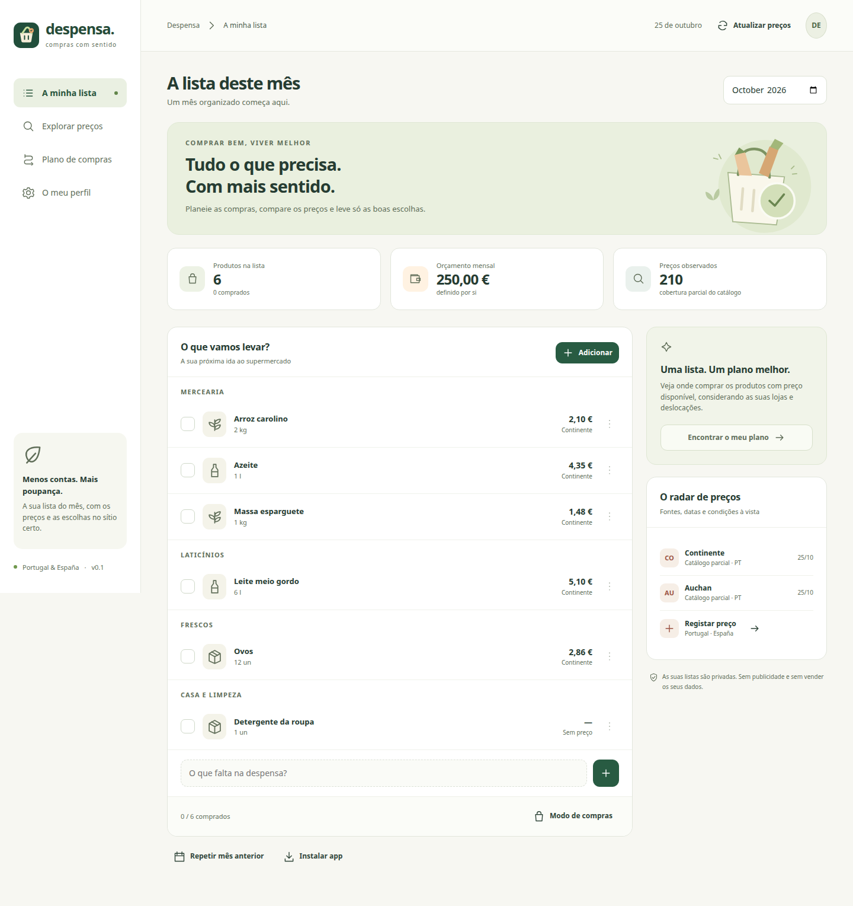

# Despensa · shopping that makes sense

[Português](../README.md) · [Español](README.es.md) · [Sources and methodology](SOURCES.md) · [Authelia and Rumo](../integrations/README.md)

Despensa is a personal shopping app you host on your own computer or NAS. It organises monthly lists, **looks up prices automatically** in Portuguese and Spanish supermarkets, and builds a plan to buy better: which stores, which day, which hour. The interface is in European Portuguese and Spanish, works on desktop and mobile, and installs as a PWA.



## Getting started

Requires Docker and Docker Compose. No AI keys or paid services needed.

```sh
git clone https://github.com/hubertdungen/Despensa.git
cd Despensa
docker compose up -d --build
```

Open `http://SERVER-IP:8108` and create an account (or configure direct sign-in with Authelia). Data lives in the `despensa-data` Docker volume. The first account enables the daily price collection; you can also press **Atualizar preços** (update prices).

To install on a phone and use the list offline, serve it through a reverse proxy with **valid HTTPS**. On Android/desktop use the browser's install option; on iPhone, **Share → Add to Home Screen**. Windows `.exe` and Android `.apk` installers are not available yet.

Caddy example:

```caddyfile
shopping.example.org {
    reverse_proxy 127.0.0.1:8108
}
```

Keep the `Host` header; `X-Forwarded-Proto: https` enables secure cookies. `/api/health` is for monitoring. To close sign-ups, set `DESPENSA_REGISTRATION: "false"` and run `docker compose up -d`.

## What it does

- **Monthly lists** with quantities, notes and purchase dates; repeat the previous month; a shopping mode with large controls and an offline list that syncs when you are back online.
- **Automatic price research** for Continente, Auchan, Pingo Doce, Lidl PT/ES, Aldi PT/ES, Intermarché, Mercadona PT/ES, Makro PT/ES, Recheio, Carrefour, DIA, Eroski and Alcampo, through catalogues, JSON-LD, embedded product data, microdata and official sitemaps. A priority queue serves the products you ask for; failures retry progressively; a radar shows the real state of each chain.
- **Honest comparisons**: per litre/kg/unit, whole packs only, observations older than 72 h are left out of plans, ambiguous offers are excluded, and incomplete baskets never beat a complete one.
- **Trip-aware planner**: compares *purchases + the whole trip* (fuel/energy, parking, tolls) for up to four stores per outing, using your home and work locations. A 0 km detour does not mean free fuel.
- **When is it worth going? (0.7)** With your work schedule, it compares the next 7 days (before work, after work, later from home, free days) using typical hourly traffic and store opening hours from OpenStreetMap, counts only the *extra* distance over your normal home↔work route, and keeps an up-to-date recommendation on its own.
- **Car and fuel**: pick make/model/year from EEA registration data (year can be estimated from the plate), or enter real consumption; log refuels to get your real L/100 km and cost per km.
- **Public transport** via [Transitous](https://transitous.org/api/) with a per-boarding price you set.
- **Monthly budget and savings**: reads the supermarket line of your [Rumo](../integrations/README.md) budget; records purchases and reports spending and savings against your usual store or a confirmed reference, with travel costs shown separately.
- **Light background research and a list that carries itself into the new month (0.8).**
- Export your data as JSON.

## Prices: what to expect

**A configured source does not mean every price of that store is available.** Some chains require a location, account or professional access, or return pages without readable prices; the app shows that state and retries instead of inventing a price. Recheio leaflet prices are Cash, excluding VAT, and are kept out of personal plans. Prices can vary by region and store. See [sources and limits](SOURCES.md).

## Privacy

Lists, accounts, preferences and manual prices stay in your installation's database; automatically observed public prices are shared between accounts of that installation. Passwords are hashed with scrypt and session tokens are hashed. No analytics, no ads, no external fonts. Store images go through a proxy restricted to known image domains. Address text and coordinates are sent only as needed to Nominatim, Overpass, OSRM (and TomTom or Transitous if you enable them); you can point to your own services with `DESPENSA_GEOCODER_URL`, `DESPENSA_OVERPASS_URL`, `DESPENSA_ROUTER_URL`. Map data © [OpenStreetMap contributors](https://www.openstreetmap.org/copyright). Signing out deletes the device's offline copy, so do not sign out with unsynced changes.

## Development

Python 3.12+, Flask/Waitress, SQLite (WAL), plain HTML/CSS/JS with no build step. Run a single instance per database.

```sh
python3 -m venv .venv
.venv/bin/pip install -r requirements-dev.txt
.venv/bin/python -m pytest -q
.venv/bin/python app.py
```

Browser tests: `npm ci`, `npx playwright install chromium`, `npm run test:e2e`. See [CONTRIBUTING](../CONTRIBUTING.md) and [SECURITY](../SECURITY.md).

## License

**AGPL-3.0-or-later.** Free for personal use and usable commercially under the license terms; modified versions offered over a network must honour the AGPL. The code license grants no rights over the stores' content, trademarks or databases, and there is no affiliation with the supermarkets mentioned.

<p align="center"><a href="https://dlforge.dungenlabs.com"><picture><source media="(prefers-color-scheme: dark)" srcset="branding/dlforge-logo-negative.svg"><source media="(prefers-color-scheme: light)" srcset="branding/dlforge-logo.svg"></picture></a></p>
